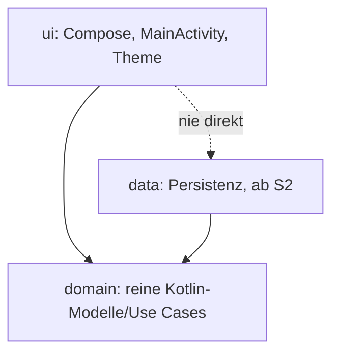

# uchilab-todo

Kostenlose Offline-Todo-App für Android (Arbeitstitel, späterer Name: Kerbholz).

## 1. Grundsätze
- Kostenlos, ohne Abo und ohne In-App-Käufe.
- Funktioniert offline, ohne Anmeldung.
- Keine Tracker, keine Werbe-, Analytics- oder Cloud-SDKs, keine Internet-Berechtigung (wird in der Pipeline geprüft).
- Daten bleiben lokal, auch Android Auto Backup ist abgeschaltet.
- Oberfläche auf Deutsch und Englisch.

## 2. Voraussetzungen
- JDK 21
- Android SDK mit Plattform 37 (`platforms;android-37.0`) und Build-Tools; Umgebungsvariable `ANDROID_HOME` gesetzt
- Android Studio ist nicht nötig. Für die Skripte unter `tools/checks`: `bash`, `curl`, `sha256sum`, `tar`.

## 3. Bauen
```
./gradlew assembleDebug
```
Die APK liegt danach unter `app/build/outputs/apk/debug/app-debug.apk` und lässt sich z. B. mit `adb install` installieren.

Release-Build mit R8 (unsigniert, Signierung ist noch nicht Teil des Projekts): `./gradlew assembleRelease`.

Nach dem ersten Download aller Abhängigkeiten funktioniert der Build auch ohne Netz: `./gradlew --offline assembleDebug`. (Robolectric lädt die Android-Laufzeit für die Tests einmalig nach.)

## 4. Testen
```
./gradlew testDebugUnitTest   # Unit- und UI-Tests (Robolectric, ohne Emulator)
./gradlew lint                # Android Lint
./gradlew privacyCheck        # Datenschutz-Checks (siehe 6) inklusive ihrer eigenen Tests
tools/checks/secret-scan.sh   # Secret-Scan (gitleaks)
tools/checks/vuln-scan.sh     # Schwachstellenprüfung der Abhängigkeiten (osv-scanner, offline)
```
Alles zusammen, wie in der Pipeline: `./gradlew assembleDebug assembleRelease testDebugUnitTest lint privacyCheck`

## 5. Projektstruktur

```
app/                     Android-App (Kotlin, Jetpack Compose)
  src/main/kotlin/de/uchilab/todo/ui   Oberfläche
  src/test/              Unit- und UI-Tests (JVM)
gradle/                  Version Catalog, Wrapper, verification-metadata.xml
tools/checks/            Datenschutz-Checks, Secret-Scan, Schwachstellen-Scan
docs/adr/                Architekturentscheidungen
.github/workflows/       Pipeline
```
Die Domain kennt weder Android noch Compose; `domain` und `data` entstehen ab S2.

## 6. Datenschutz-Checks
`./gradlew privacyCheck` prüft die zusammengeführten Manifeste (Debug und Release) und alle Abhängigkeiten:
- keine Berechtigung `INTERNET` oder `ACCESS_NETWORK_STATE`, kein Klartext-Verkehr,
- `allowBackup="false"`,
- keine exportierten Komponenten außer der Start-Activity,
- jede Abhängigkeit muss auf der Allowlist stehen (`tools/checks/allowlist.txt` für die App, `tools/checks/allowlist-test.txt` zusätzlich für Tests). Bekannte Tracker stehen in `denylist.txt` und führen zu einer klaren Fehlermeldung.

**Neue Abhängigkeit aufnehmen:** Gruppe (oder `gruppe:artefakt`) bewusst in die passende Allowlist eintragen. Die Änderung wird im Pull Request geprüft. Danach `./gradlew :app:dependencies --write-locks` und `./gradlew --write-verification-metadata sha256 assembleDebug assembleRelease testDebugUnitTest lint` ausführen und die geänderten Dateien einchecken.

Die Checks sind selbst getestet, inklusive Negativtests (`tools/checks/src/test`, `secret-scan-selftest.sh`, `vuln-scan-selftest.sh`).

## 7. Pipeline
Bei jedem Pull Request und Push auf `main` läuft GitHub Actions (`.github/workflows/ci.yml`), ohne Secrets:
1. Build (Debug), Release-Build mit R8, Unit- und UI-Tests, Lint, `privacyCheck`
2. Secret-Scan (Arbeitsbaum und Git-Historie)
3. Schwachstellenprüfung der Abhängigkeiten

Schlägt ein Schritt fehl, ist der Check rot. Alle Werkzeuge laufen im Runner, es werden keine Projektdaten an Dritte gesendet. Mehr dazu in `docs/adr/0001-technologie.md`.

## 8. Beitragen
- Code, Commits und Bezeichner auf Englisch, Doku und README auf Deutsch.
- Testgetrieben: erst Tests, dann Umsetzung.
- Lizenz: siehe `LICENSE`.
