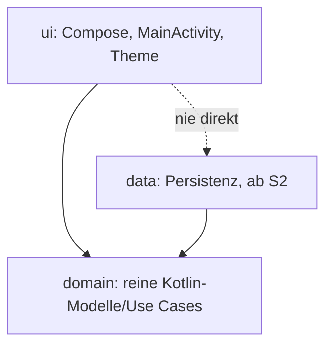

# uchilab-todo

Kostenlose Offline-Todo-App für Android (Arbeitstitel, späterer Name: Kerbholz).

## 1. Grundsätze
- Kostenlos, ohne Abo und ohne In-App-Käufe.
- Funktioniert offline, ohne Anmeldung.
- Keine Tracker, keine Werbe-, Analytics- oder Cloud-SDKs, keine Internet-Berechtigung (wird in der Pipeline geprüft).
- Daten bleiben lokal, auch Android Auto Backup ist abgeschaltet.
- Oberfläche auf Deutsch und Englisch.

## 2. Voraussetzungen
- JDK 21
- Android SDK mit Plattform 37 (`platforms;android-37.0`) und Build-Tools; Umgebungsvariable `ANDROID_HOME` gesetzt
- Android Studio ist nicht nötig. Für die Skripte unter `tools/checks`: `bash`. Secret-Scan und Schwachstellen-Scan laufen in der CI als offizielle Container-Images (siehe 4).

## 3. Bauen
```
./gradlew assembleDebug
```
Die APK liegt danach unter `app/build/outputs/apk/debug/app-debug.apk` und lässt sich z. B. mit `adb install` installieren.

Release-Build mit R8 (unsigniert, Signierung ist noch nicht Teil des Projekts): `./gradlew assembleRelease`.

Nach dem ersten Download aller Abhängigkeiten funktioniert der Build auch ohne Netz: `./gradlew --offline assembleDebug`. (Robolectric lädt die Android-Laufzeit für die Tests einmalig nach.)

## 4. Testen
```
./gradlew testDebugUnitTest   # Unit- und UI-Tests (Robolectric, ohne Emulator)
./gradlew lint                # Android Lint
./gradlew privacyCheck        # Datenschutz-Checks (siehe 6) inklusive ihrer eigenen Tests
./gradlew assembleRelease r8Check   # R8 ist im Release-Build wirklich aktiv
```
Wrapper-Prüfung, Secret-Scan und Schwachstellen-Scan laufen in der CI mit Standardwerkzeugen (`gradle/actions/wrapper-validation`, Images `ghcr.io/gitleaks/gitleaks` und `ghcr.io/google/osv-scanner`, Versionen und Digests in `ci.yml`). Lokal mit Docker oder Podman, z. B. `podman run --rm -v "$PWD:/repo" -w /repo <image aus ci.yml> dir --no-banner --redact --config tools/checks/gitleaks.toml .`. `tools/checks/vuln-scan.sh` teilt `app/gradle.lockfile` vorher in ausgelieferte und andere Bibliotheken auf (`build/osv/`).
Alles zusammen, wie in der Pipeline: `./gradlew assembleDebug assembleRelease testDebugUnitTest lint r8Check privacyCheck`

Gradle kompiliert Kotlin im eigenen Prozess (kein Kotlin-Daemon), ein unbenutzter Gradle-Daemon beendet sich nach 10 Minuten (`gradle.properties`, `tools/checks/gradle.properties`). Nach dem Arbeiten trotzdem `./gradlew --stop`.

**CI-Lauf für Prüfer:** Jeder Lauf lädt hoch, auch wenn er rot ist (14 Tage, Name endet auf den Commit-SHA, bei Pull Requests den Head-Commit): `reports-<sha>` (Testberichte der App und von `tools/checks` als JUnit-XML und HTML, Lint als HTML, XML und SARIF), `debug-apk-<sha>`, `r8-mapping-<sha>` (`mapping.txt` des Release-Builds) und `emulator-logs-<sha>` (Logcat). Liste: `gh api repos/JanSiebrands/uchilab-todo/actions/runs/<run-id>/artifacts --jq '.artifacts[].name'`. `tools/ci/review-artifacts.sh` sammelt die Dateien und wird rot, wenn nach grünem Build eine fehlt. Dazu kommt `screenshots-<sha>` aus dem Job „Screenshots“.

**Gegenproben:** Die Gegenprobe einer Prüfregel ist ihr Unit-Test unter `tools/checks/src/test` (läuft mit `privacyCheck` und im Job `build`). Daneben gibt es höchstens ein Gegenproben-Skript je Job, nur wenn sich `tools/`, `.github/` oder die Gradle-Konfiguration ändern (`tools/ci/pipeline-changed.sh`): `tools/checks/counterprobes/privacy-check-red.sh` (Job „Counterprobes“, baut drei Fehler in eine Wegwerf-Kopie und erwartet `privacyCheck` rot mit allen drei Meldungen), `16b-deleted-after-reboot-emulator.sh` (Job „App start on emulator“) und `screenshots-check-red.sh` (Job „Screenshots“). Der eingecheckte Stand wird nicht verändert. Hintergrund in ADR 0002, Abschnitt „Gegenproben“.

**App-Start auf dem Emulator:** bei laufendem Emulator `tools/checks/emulator-run.sh` (Start als Debug und Release mit R8, Aufgaben nach Prozessende und Neustart, beschädigte Datenbank wird nicht gelöscht; mit `RUN_COUNTERPROBE=true` zusätzlich Gegenprobe 16b). Die unsignierte Release-APK wird dabei mit einem frisch erzeugten Wegwerf-Schlüssel signiert. Den Emulator danach beenden.

**APK zum Ausprobieren auf dem Emulator:** `tools/ci/tryout-install-test.sh <apk> <minSdk>` prüft auf einem laufenden Emulator mit Android-API = `minSdk` (Wert aus `tools/ci/tryout-min-sdk.sh`): Installation, Update mit `adb install -r` und Start (gemeinsame Start-Prüfung `tools/checks/app-start-lib.sh`). Anders als `app-start.sh` signiert es nicht selbst, eine unsignierte APK wird rot.

## 5. Projektstruktur

```
app/                     Android-App (Kotlin, Jetpack Compose)
  src/main/kotlin/de/uchilab/todo/ui   Oberfläche
  src/test/              Unit- und UI-Tests (JVM)
gradle/                  Version Catalog, Wrapper, verification-metadata.xml
tools/checks/            Datenschutz-Checks, Secret-Scan, Schwachstellen-Scan
docs/adr/                Architekturentscheidungen
.github/workflows/       Pipeline
```
Die Domain kennt weder Android noch Compose; `domain` und `data` entstehen ab S2.

## 6. Datenschutz-Checks
`./gradlew privacyCheck` prüft die zusammengeführten Manifeste (Debug und Release), den eigenen Quelltext der App und alle Abhängigkeiten:
- keine Berechtigung `INTERNET` oder `ACCESS_NETWORK_STATE`, kein Klartext-Verkehr,
- `allowBackup="false"`,
- keine exportierten Komponenten außer der Start-Activity; die Start-Activity muss im Manifest stehen und hat genau einen `intent-filter` mit `MAIN`/`LAUNCHER` ohne `data` (Security P3),
- das Release-Manifest ist nicht `debuggable` (Security P1),
- kein `android:backupAgent`, kein `hasFragileUserData="true"`, kein `directBootAware="true"` an `application` oder einer Komponente (Security P2),
- keine Logs im Quelltext der App: kein `android.util.Log`, `println`/`print`, `System.out`/`System.err`, `printStackTrace`, keine Logging-Bibliothek, kein `setQueryCallback` (Security P4, DSGVO P2),
- kein externer, geteilter, Cache- oder Direct-Boot-Speicher im Quelltext der App (z. B. `getExternalFilesDir`, `MediaStore`, Storage Access Framework, `cacheDir`, `createTempFile`, `createDeviceProtectedStorageContext`) (Security P6, DSGVO P3). Geprüft werden alle `.kt`/`.java` unter `app/src/`, außer `test*`, `androidTest*` und `testFixtures*`. Treffer in Kommentaren zählen, Ausnahmen gibt es nicht; die Regeln stehen in `tools/checks/src/main/kotlin/de/uchilab/checks/SourceCheck.kt` und werden nur nach Rückfrage bei Security und DSGVO geändert,
- jede Berechtigung muss in `tools/checks/permissions-allowlist.txt` stehen (auch über Abhängigkeiten eingeschleppte); `INTERNET` und `ACCESS_NETWORK_STATE` bleiben auch dann verboten,
- Backup und Transfer aus: das Manifest verweist auf `dataExtractionRules` und `fullBackupContent`, beide Dateien existieren, `<cloud-backup>`, `<device-transfer>` und `<cross-platform-transfer platform="ios">` sind vorhanden, alle neun Bereiche sind ausgeschlossen, kein `<include>`,
- jede Abhängigkeit muss auf der Allowlist stehen (`tools/checks/allowlist.txt` für die App, `tools/checks/allowlist-test.txt` zusätzlich für Tests). Bekannte Tracker stehen in `denylist.txt` und führen zu einer klaren Fehlermeldung.

**Neue Abhängigkeit aufnehmen:** Gruppe (oder `gruppe:artefakt`) bewusst in die passende Allowlist eintragen. Die Änderung wird im Pull Request geprüft. Danach `./gradlew :app:dependencies --write-locks` und `./gradlew --write-verification-metadata sha256 assembleDebug assembleRelease testDebugUnitTest lint` ausführen und die geänderten Dateien einchecken.

Die Checks sind selbst getestet, inklusive Negativtests (`tools/checks/src/test`).

**Gespeicherte Felder (DSGVO P4):** keine Pipeline-Prüfung. Die Feldliste steht in `docs/datenschutz/gespeicherte-felder.md` und wird bei jeder Änderung am Room-Schema (`app/schemas/`) im selben PR nachgezogen. Eine Änderung an `app/schemas/**` oder an einer Klasse mit `@Entity`, `@Database` oder `@Dao` ist Anlass für Security und DSGVO (ADR 0002, Entscheidung 10).

## 7. Pipeline
Bei jedem Pull Request, Push auf `main` und täglich auf `main` läuft GitHub Actions (`.github/workflows/ci.yml`), ohne Secrets:
1. Wrapper-Prüfung (`gradle/actions/wrapper-validation`), dann Build (Debug), Release-Build mit R8, Unit- und UI-Tests, Lint, `r8Check`, `privacyCheck`
2. Gegenproben: `privacy-check-red.sh`, nur bei Änderungen an `tools/`, `.github/` oder der Gradle-Konfiguration (sonst ist der Job nach dem Pfadfilter grün)
3. Emulator: App-Start als Debug und als Release mit R8, Aufgaben nach Prozessende und Neustart, beschädigte Datenbank wird nicht gelöscht; Gegenprobe 16b nur mit Pfadfilter
4. Screenshots des Release-Builds als Beleg für Designer und PO. Geprüft wird nur, dass jede erwartete Datei da und nicht leer ist. Der Emulator-Schritt wird bei einem Ausfall einmal wiederholt
5. Secret-Scan (Arbeitsbaum und Git-Historie, Image `ghcr.io/gitleaks/gitleaks`)
6. Schwachstellenprüfung der Abhängigkeiten (Image `ghcr.io/google/osv-scanner`)
7. Nur bei Pull Requests, wenn alle anderen Jobs außer den Screenshots grün sind: APK zum Ausprobieren bauen, signieren, prüfen, auf dem Emulator mit API = `minSdk` installieren und starten, dann hochladen (siehe 8).

Lint meldet keine neueren Versionen (die Pipeline wird ohne Codeänderung nicht rot). Neue Versionen kommen als Pull Request von Renovate (`.github/workflows/renovate.yml`, wöchentlich, nur auf `main`, Lockfile und `verification-metadata.xml` im selben PR). Update-PRs werden nie automatisch gemergt. Renovate nutzt das Token des Bot-Kontos `uchilabbot` aus dem Repo-Secret `RENOVATE_TOKEN` (Entscheidung von Jan: keine GitHub App, damit keine zweite Identität Pull Requests freigeben kann). Einen Lauf von Hand startest du mit `gh workflow run renovate.yml --ref main`.

Renovate gibt `./gradlew` nur ausgewählte Umgebungsvariablen weiter. `ANDROID_HOME` reicht der Workflow ausdrücklich über `RENOVATE_CUSTOM_ENV_VARIABLES` durch (Einzeiler in `renovate.yml`). Die heutigen Gradle-Befehle von Renovate brauchen das SDK nicht, das ist eine Absicherung für künftige AGP-Versionen. Andere Variablen, vor allem `RENOVATE_TOKEN`, gelangen nicht zu Gradle (kein `exposeAllEnv`). Mehr in ADR 0002, Punkt 4.

**Rote Läufe abfragen:** `tools/ci/main-run-status.sh` fragt mit `gh run list` (nur lesend) den jüngsten abgeschlossenen Lauf von `ci.yml` und `renovate.yml` auf `main` ab. Abgebrochene und übersprungene Läufe zählen nicht. Ausgabe je Workflow eine Zeile `GREEN|RED <workflow> <url> since=<datum> count=<n>` (`since`/`count`: seit wann und wie oft in Folge, höchstens über die letzten 20 Läufe), bei einem Fehler `ERROR <workflow> <grund>`. Exit-Code `0` alles grün, `1` mindestens ein Workflow rot, `2` Abfrage gescheitert oder kein abgeschlossener Lauf (hat Vorrang, die übrigen Zeilen stehen trotzdem in der Ausgabe). Der PO ruft das Skript täglich im Abgleich der Pull Requests auf und legt bei Rot oder Fehler ein Paperclip-Issue an. Andere Branches oder Workflows: `--branch <b> --workflow <datei>`. `ci.yml` lässt sich mit `gh workflow run ci.yml --ref <branch>` von Hand starten.

Schlägt ein Schritt fehl, ist der Check rot. Alle Werkzeuge laufen im Runner, es werden keine Projektdaten an Dritte gesendet. Mehr dazu in `docs/adr/0001-technologie.md` und `docs/adr/0002-pipeline-pruefungen.md`.

## 8. APK zum Ausprobieren

Zu jedem Pull Request mit grüner Pipeline gibt es eine fertige APK zum Ausprobieren (ADR 0004).

**Wo:** im Pull Request unter „Checks“ → Lauf „CI“ → Job „APK to try out“ → Zusammenfassung des Laufs. Dort stehen der Download-Link, der Dateiname `uchilab-todo-pr<Nummer>-<Commit>.apk` (Commit: die ersten 7 Zeichen des letzten Commits im Pull Request), die SHA-256-Prüfsumme der APK und der Fingerabdruck des Zertifikats. Die Datei ist auch unter „Artifacts“ des Laufs zu finden und bleibt 30 Tage verfügbar. Der Download ist direkt die APK, kein ZIP. Ist ein Check rot, gibt es keine APK.

**Installieren:** die Datei auf das Gerät laden und öffnen. Android fragt beim ersten Mal, ob der Browser oder Dateimanager Apps installieren darf („Installation aus unbekannten Quellen“), das einmal erlauben. Alternativ am Rechner: `adb install -r <datei>`.

**Update:** Eine neuere APK aus demselben Pull Request lässt sich über die installierte installieren, die Daten bleiben erhalten. Die Zusammenfassung zeigt dann „Schlüssel wiederverwendet“ und denselben Fingerabdruck.

**Wann vorher deinstallieren:** Steht in der Zusammenfassung **„Neuer Schlüssel: alte Version vorher deinstallieren“**, hat die APK eine andere Signatur als die installierte. Das passiert beim ersten Lauf eines Pull Requests, wenn ein Pull Request 7 Tage lang keinen Lauf hatte (GitHub löscht dann den Schlüssel aus dem Cache), und beim Wechsel zu einer APK aus einem anderen Pull Request (jeder Pull Request hat einen eigenen Schlüssel). Dann die App deinstallieren und neu installieren; die Testdaten gehen dabei verloren.

**Was die APK ist:** der Release-Build mit R8, nicht debuggable, signiert mit einem Wegwerf-Schlüssel des Pull Requests (kein Secret, nichts im Repo). Vor dem Hochladen wurde genau diese Datei auf einem Emulator mit der niedrigsten unterstützten Android-Version installiert, aktualisiert und gestartet. Nur zum Ausprobieren mit erfundenen Testaufgaben, kein Store-Build.

## 9. Beitragen
- Code, Commits und Bezeichner auf Englisch, Doku und README auf Deutsch.
- Testgetrieben: erst Tests, dann Umsetzung.
- Lizenz: siehe `LICENSE`.
