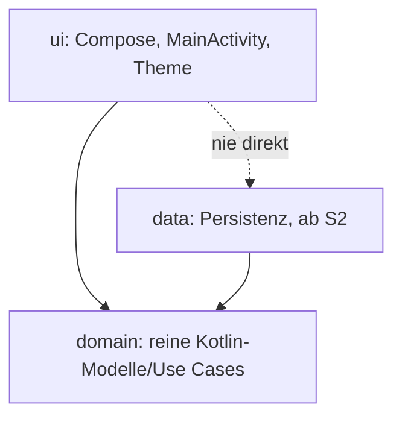

# ADR 0001: Technologie, Struktur, Tests und Pipeline für S1

Status: angenommen (Plan des Architekten in UCH-14, Entscheidungen von Jan in UCH-15)

## 1. Technologie
- Kotlin und Jetpack Compose (Material 3), ein einzelnes Gradle-Modul `app` (YAGNI; Aufteilung in Module erst mit Grund und eigenem ADR).
- Gradle Kotlin DSL, Wrapper eingecheckt (mit Prüfsumme der Distribution), Version Catalog `gradle/libs.versions.toml`, alle Versionen fest gepinnt (keine dynamischen Versionen).
- Gradle Dependency Verification (`gradle/verification-metadata.xml`, SHA-256) und Dependency Locking (`app/gradle.lockfile`).
- Keine DI-Frameworks, keine Netzwerk-Bibliotheken. Für S2 vorgesehen: Room (AndroidX), Entscheidung per ADR bei S2.
- minSdk 26 (Android 8.0): deckt praktisch alle aktiven Geräte, vermeidet Desugaring für `java.time`, Adaptive Icons und Notification-Channels sind Standard.
- compileSdk und targetSdk 37 (aktuelle stabile API zum Umsetzungszeitpunkt; Compose 1.12 verlangt compileSdk 37).
- Application-ID `de.uchilab.todo` (Arbeitsname; Umstellung auf den Namen „Kerbholz“ in S12 an einer Stelle).
- Sprachen: Deutsch und Englisch (Entscheidung Jan). Alle sichtbaren Texte sind String-Ressourcen (`values`, `values-de`), Fallback Englisch.

## 2. Projektstruktur

Abhängigkeitsrichtung `ui → domain ← data`. Die Domain kennt weder Android noch Compose noch Room. In S1 existiert nur `ui`.

## 3. Tests
- JVM-Unit-Tests (JUnit): Ressourcen-Parität Deutsch/Englisch.
- UI-Start-Test mit Robolectric auf der JVM (`createAndroidComposeRule<MainActivity>`), auch mit Dunkelmodus und verschiedenen Systemsprachen. Läuft ohne Emulator. `androidTest` (Emulator) erst, wenn ein Test echte Gerätefunktion braucht.
- Robolectric läuft mit SDK 36 (`app/src/test/resources/robolectric.properties`), weil die Espresso-Eingabeinjektion SDK 37 noch nicht unterstützt.
- Die Datenschutz-Checks haben eigene Tests inklusive Negativtests (`tools/checks/src/test`).

## 4. Pipeline und Datenschutz-Checks
GitHub Actions (`.github/workflows/ci.yml`) bei Pull Request und Push auf `main`; `permissions: contents: read`, keine Secrets, Actions auf Commit-SHA gepinnt. Alle Werkzeuge laufen lokal im Runner, ohne Konto und ohne Datenversand an Dritte.

| Prüfung | Werkzeug | Negativtest |
|---|---|---|
| Build (Debug) und R8/Minify im Release-Build (unsigniert) | `assembleDebug assembleRelease` | Build bricht bei R8-Fehlern |
| Unit- und UI-Tests | `testDebugUnitTest` | – |
| Lint (Warnungen sind Fehler) | `lint` | – |
| Manifest und Abhängigkeiten | `privacyCheck` (Gradle-Plugin in `tools/checks`) | `tools/checks/src/test` |
| Secret-Scan (Arbeitsbaum und Historie) | gitleaks, Version und SHA-256 fest in `tools/checks/ensure-tools.sh` | `secret-scan-selftest.sh` |
| Schwachstellen der Abhängigkeiten | osv-scanner im Offline-Modus (nur die Advisory-Datenbank wird geladen, die Abhängigkeitsliste verlässt den Rechner nicht), Eingabe `app/gradle.lockfile` | `vuln-scan-selftest.sh` |

`privacyCheck` prüft die *gemergten* Manifeste (Debug und Release): keine Berechtigung `INTERNET` oder `ACCESS_NETWORK_STATE`, kein `usesCleartextTraffic`, `allowBackup` ist `false`, keine exportierten Komponenten außer `MainActivity` (Ausnahmen: Komponenten mit Berechtigung `DUMP`, z. B. der Profile-Installer von AndroidX, und im Debug-Build die Test-Hilfsaktivität von `ui-test-manifest`). Alle auflösbaren Classpaths werden gegen eine Allowlist von Gruppen geprüft: `allowlist.txt` für alles, was in die App kommt, `allowlist-test.txt` zusätzlich nur für Test-Classpaths. Die Denylist (`denylist.txt`) liefert nur die klare Fehlermeldung für bekannte Tracker.

Der Schwachstellen-Scan lässt den Build nur bei Funden in Bibliotheken scheitern, die in der App landen. Funde in Test- und Build-Werkzeugen werden gemeldet, brechen aber nicht ab. Bekannte Einschränkung: Neu veröffentlichte Advisories können einen unveränderten Pull Request rot machen; das ist gewollt.

Branch-Protection und Required Checks setzt Jan.

## 5. Android Auto Backup: aus
Firmenregel „nur lokal“ gilt auch für System-Backups (Bestätigung durch Jan in UCH-15).
- `android:allowBackup="false"`
- `android:dataExtractionRules` (Android 12+) und `android:fullBackupContent` (älter) schließen alle Domains aus, inklusive `<cloud-backup>` und `<device-transfer>`.
- `privacyCheck` sichert das ab.
- Folge: Bei Geräteverlust oder -wechsel sind Aufgaben weg. Ein manueller Export/Import als Datei wäre eine spätere Story.

## 6. Abweichungen und Hinweise zur Umsetzung
- Lint-Regel `ObsoleteLintCustomCheck` ist abgeschaltet: Die Lint-Checks von `androidx.lifecycle` sind gegen eine ältere Kotlin-Analyse-API gebaut, Lint überspringt sie selbst. Bei einem Update von androidx.lifecycle prüfen.
- Robolectric benötigt `--add-exports=java.base/jdk.internal.access=ALL-UNNAMED` für die Unit-Tests.
- Die Android-Plattform 37 muss im SDK installiert sein (AGP lädt sie bei akzeptierten Lizenzen automatisch nach).
