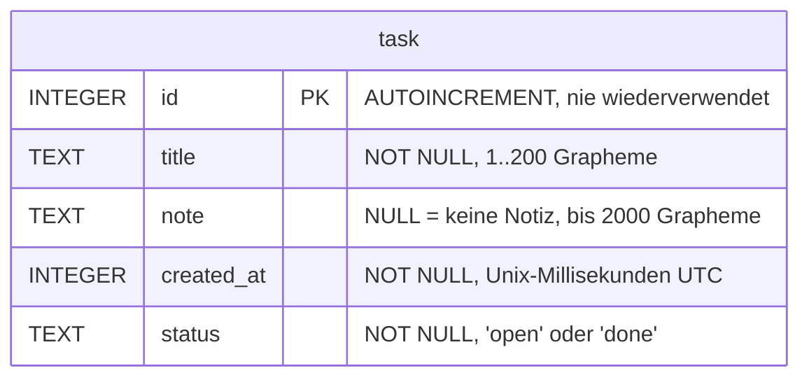

# ADR 0003: Datenhaltung der Aufgaben

Status: angenommen (Plan des Architekten in UCH-47, Umsetzung UCH-51, Story S2 / UCH-31)

## Kontext
S2 speichert erstmals Daten. Es gelten die Vorgaben von Security ([`docs/sicherheit/datenhaltung.md`](../sicherheit/datenhaltung.md)) und DSGVO ([`docs/datenschutz/vorgaben.md`](../datenschutz/vorgaben.md)); wo sie sich unterscheiden, das Strengere. Alles bleibt lokal, auch bei System-Backups.

## Entscheidungen
| Thema | Entscheidung | Grund |
|---|---|---|
| Speicher | Room 3 (`androidx.room3`, 3.0.x) mit der SQLite des Systems über `KeepFileSQLiteDriver` | AndroidX-Standard, Flow für Änderungen, parametrisierte Abfragen per Annotation (D6), Schema-Export für Migration (S11). Kein `BundledSQLiteDriver`: nativer Code (Security A4). |
| Annotation-Prozessor | KSP | Room 3 verlangt KSP (Security A3). |
| Schema-Export | Room-Gradle-Plugin, `schemaDirectory("$projectDir/schemas")`, eingecheckt | Grundlage für Migrationen und die Feldliste (DSGVO P4). |
| Keine Verschlüsselung | kein SQLCipher, kein `security-crypto` | Security D4. |
| Kein Destruktiv-Fallback | verboten: `fallbackToDestructiveMigration*`, `allowDataLossOnRecovery()` | Würde bei einem Fehler stillschweigend alle Aufgaben löschen. Geprüft durch `SourceCheck`. Migrationen kommen in S11. |
| Treiber | `KeepFileSQLiteDriver` mit eigenem `DatabaseErrorHandler`, der nie löscht; 0 Byte gilt als beschädigt (UCH-80) | Der Standard von Android löscht eine beschädigte Datei beim Öffnen und bei jeder Abfrage und startet leer. Die App zeigt stattdessen den Lesefehler, die Datei bleibt. |
| Kein Logging | weder `setQueryCallback` noch eigenes Logging in `app/src/main` | Security L2, DSGVO V5. |
| Kein DI-Framework | `TaskDatabase.create(context)`; Verdrahtung kommt mit S3 | ADR 0001. |

## Datenformat Version 1
Datei `tasks.db` (Konstante `TaskDatabase.DATABASE_NAME`, ohne Pfad). Die Formatversion ist die Room-Version (SQLite `user_version`, exportiertes Schema `app/schemas/.../1.json`).

- Genau diese fünf Felder (DSGVO V2), keine weitere Tabelle. SQLite legt für `AUTOINCREMENT` `sqlite_sequence` an, Room `room_master_table`; beide enthalten keine Inhalte.
- `status` wird explizit gemappt (`OPEN` ↔ `open`, `DONE` ↔ `done`), nicht über `Enum.name`.
- Löschen ist ein physisches `DELETE` (DSGVO V4).
- Gespeichert wird der getrimmte Wert (Titel und Notiz). Im Titel wird jeder Zeilenumbruch (`\r\n`, `\n`, `\r`, U+0085, U+2028, U+2029) zu einem Leerzeichen ersetzt, dann getrimmt, dann die Länge geprüft (Entscheidung PO, UCH-51 Nachtrag 2026-11-07). Die Notiz behält ihre Umbrüche.
- Zeit kommt aus einer injizierten `java.time.Clock`.

## Reihenfolge
Sortiert wird nach `id DESC`, nicht nach `created_at`. Die ID ist streng steigend und wird nie wiederverwendet, daher bleibt die Reihenfolge bei zurückgestellter Uhr, Zeitzonenwechsel und gleicher Millisekunde fest. Ändern berührt ID und `created_at` nicht. Kein zusätzliches Feld nötig.

## Backup-Domain `database` (Security B1)
Der Name `tasks.db` hat keinen Pfad, Room löst ihn über `Context.getDatabasePath` auf (Domain `database`). Belegt durch (1) den Code, (2) den Robolectric-Test „the database lives in the databases folder and nowhere else“ über die Produktions-Fabrik, (3) die unveränderten Backup-Regeln mit `BackupRulesCheck` und den Gegenproben 06a bis 06f, die alle Domains ausschließen.

## Feldliste (DSGVO P4)
Quelle ist das exportierte Schema unter `app/schemas/`. Die Prüfung gegen `tools/checks/stored-fields.txt` folgt als eigenes Issue an CI/CD (Plan UCH-47, Abschnitt 8).

## Folgen
- Der Treiber nutzt eine eingeschränkte API von androidx.sqlite (`AndroidSQLiteConnection`, Unterdrückung von `RestrictedApi` nur an dem einen Aufruf). Jedes Renovate-Update von `androidx.sqlite` muss `CorruptDatabaseTest` und die DAO-Tests mit diesem Treiber grün haben. Fällt die Klasse weg, wird eine eigene schlanke `SQLiteConnection` über `SQLiteDatabase` gebaut (neue Story). Alle Tests laufen über `TaskDatabase.create` und damit über diesen Treiber.
- Der Journal-Modus ist fest WAL (`setJournalMode(WRITE_AHEAD_LOGGING)` passend zu den Öffnen-Flags des Treibers), damit das Öffnen den Dateikopf nicht verändert. Nachteil: etwas mehr Speicher auf Geräten mit wenig RAM, für eine Todo-App unerheblich.
- Die Domain (`de.uchilab.todo.domain`) kennt kein `android.*`/`androidx.*`; Grenzen (200/2000 Grapheme) prüft `TaskContent.of`, der einzige Weg zu gültigem Inhalt (Security D5).
- Das Repository fängt nur `android.database.SQLException` und meldet `STORAGE_FAILURE` ohne Ausnahme und Text (L3).
- Fehlt eine Migration, wirft Room `IllegalStateException`; es wird nichts gelöscht. Der Lesefehler dafür kommt in S11.
- S2 hat keinen Aufrufer in der App; R8 entfernt die Datenbank im Release-Build. Erst S3 prüft Room mit R8 auf dem Emulator.
- Grapheme zählt `java.text.BreakIterator`; auf alten Android-Versionen kennt ICU neuere Emoji-Folgen evtl. nicht (nur an der Grenze relevant).
