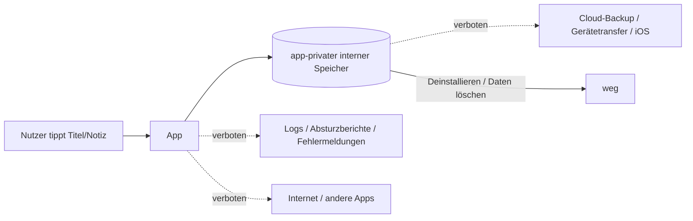

<!-- Quelle: Paperclip-Dokument `vorgaben` in UCH-41 (DSGVO), Stand 2026-11-06, ergänzt durch UCH-162, Stand 2026-11-11. Volltext, unverändert übernommen. -->
# Datenschutzvorgaben: gespeicherte Daten der Todo-App

Stand 2026-11-06, DSGVO ([UCH-41](/UCH/issues/UCH-41)). Gilt ab S2 ([UCH-31](/UCH/issues/UCH-31)) für alle Stories der Todo-App. Das sind Vorgaben für die Umsetzung, keine Rechtsberatung.

## Ausgangslage
- Gespeichert werden je Aufgabe: Titel (bis 200 Zeichen), Notiz (optional, bis 2000 Zeichen), Erstellungszeitpunkt, Status offen/erledigt, dazu eine technische ID.
- Titel und Notiz sind Freitext. Wir müssen davon ausgehen, dass dort Gesundheitsdaten, Daten Dritter oder anderes Sensibles steht. Deshalb behandeln wir **jeden Inhalt** von Titel und Notiz so, als wäre er sensibel.
- Grundsatz für alles Weitere: **uchilab und Jan bekommen diese Daten nie zu sehen.** Sie verlassen das Gerät nicht, auch nicht über Backup, Logs oder Absturzberichte. Nur dadurch bleibt die Todo-App ohne Datenschutzhinweis in der App und mit einer kurzen Datenschutzerklärung aus (siehe V6).

## Vorgaben

### V1 Speicherort: nur app-privater interner Speicher
**Vorgabe:** Aufgaben liegen ausschließlich im app-privaten internen Speicher (`filesDir`, `databases`, `shared_prefs`/DataStore unter dem App-Verzeichnis). Nicht erlaubt: externer oder gemeinsamer Speicher (`getExternalFilesDir`, `getExternalCacheDir`, `Environment.getExternalStorage*`, `MediaStore`, Storage Access Framework), gerätegeschützter Speicher (`createDeviceProtectedStorageContext`, `directBootAware`), Kopien von Inhalten in `cacheDir` oder temporären Dateien.
**Begründung:** Nur dieser Speicher ist für andere Apps unzugänglich und wird beim Deinstallieren und bei „Daten löschen“ vom System vollständig entfernt (V4). Gerätegeschützter Speicher ist schon vor dem ersten Entsperren lesbar und für eine Todo-Liste unnötig. Ob zusätzlich verschlüsselt wird, entscheidet Security in [UCH-40](/UCH/issues/UCH-40); aus Sicht DSGVO ist das keine Bedingung, solange V1 bis V5 gelten.
**Prüfung:** Pipeline (P3, neu). Speicher-Berechtigungen verhindert schon die bestehende Berechtigungs-Allowlist.

### V2 Datenminimierung: nur die genannten Felder
**Vorgabe:** Gespeichert werden nur die fünf Felder aus der Ausgangslage. Dazu kommt seit S7 (UCH-159, UCH-162) genau eine Einstellung: ob erledigte Aufgaben ausgeblendet sind, ohne Zeitstempel oder Zähler (V2a). Wo sie liegt, steht in `gespeicherte-felder.md` unter „Einstellungen“. Kein Änderungsverlauf, keine weiteren Zeitstempel, keine Geräte-, Nutzungs- oder Standortdaten, keine Statistik. Jedes weitere gespeicherte Feld, auch Einstellungen, ist ein Anlass für DSGVO (V7).
**Begründung:** Was nicht gespeichert wird, muss nicht geschützt, erklärt oder gelöscht werden (Art. 5 Abs. 1 lit. c).
**Prüfung:** Review (P4, seit UCH-124): Das Schema wird mit dem Room-Schema-Export unter `app/schemas/` abgelegt. Die Liste der gespeicherten Felder steht in `docs/datenschutz/gespeicherte-felder.md` und wird bei jeder Schema-Änderung im selben PR nachgezogen; das sehe ich in meiner Stufe. Eine Pipeline-Prüfung der Feldliste gibt es nicht mehr (Regeln aus UCH-116, ADR 0002 Entscheidung 10).

### V3 „Nur lokal“: kein Backup, kein Gerätetransfer, keine Weitergabe
**Vorgabe:**
- `android:allowBackup="false"`, `dataExtractionRules` und `fullBackupContent` schließen weiter alle neun Bereiche aus, für Cloud-Backup, Gerätetransfer und Transfer zu iOS. Kein `include`. Das ist der Stand aus S1 und reicht für jeden Speicherort nach V1, weil Datenbank, Dateien und Prefs in diesen Bereichen liegen. Es braucht dafür **keine** Änderung.
- Keine Internet-Berechtigung, keine Netzwerk-Bibliothek, keine Analytics-, Crash- oder Werbe-SDKs (bestehende Prüfungen).
- In diesem Feature verlassen Inhalte die App auf keinem Weg: kein Teilen-Intent, kein Content- oder File-Provider, keine Benachrichtigung, kein Widget, keine automatische Kopie in die Zwischenablage.
**Begründung:** Board-Entscheidung: „Nur lokal“ gilt auch für System-Backups, Backup aus ist ok, Export kommt später. Ein Backup oder Transfer würde Freitext (möglicherweise Gesundheitsdaten) zu Google bzw. auf ein anderes Gerät bringen, ohne dass der Nutzer das in der App entschieden hat. Folge für Nutzer: Beim Gerätewechsel sind die Aufgaben nicht mehr da (siehe Vorschlag in V6).
**Prüfung:** Pipeline, besteht schon: `BackupRulesCheck` und Berechtigungs-Allowlist in `privacyCheck`, abgesichert durch ihre Unit-Tests (`BackupRulesCheckTest`, `ManifestCheckTest`, früher Gegenproben 02 und 06a bis 06f) und `privacy-check-red.sh`. Exportierte Komponenten prüft Security.

### V4 Löschen
**Vorgabe:**
- **Deinstallieren und „Daten löschen“ in den Systemeinstellungen** entfernen alle Aufgaben vollständig. Das ergibt sich aus V1 und V3; die App legt nichts außerhalb des app-privaten Speichers ab.
- **Löschen einer Aufgabe** (ab S8) entfernt den Datensatz physisch aus dem Speicher, kein „gelöscht“-Kennzeichen und kein dauerhafter Papierkorb. Für „Rückgängig“ darf die gelöschte Aufgabe nur im Arbeitsspeicher gehalten werden, bis die Rückgängig-Möglichkeit endet oder der Prozess beendet wird. Nach dem Löschen liefert keine Abfrage der App die Aufgabe mehr.
**Begründung:** Wer eine Aufgabe löscht, erwartet, dass sie weg ist (Art. 17 sinngemäß). Ein verstecktes Kennzeichen hielte sensible Inhalte unbegrenzt fest.
**Prüfung:** Test (ab S8): Aufgabe mit Markertext anlegen, löschen, Rückgängig-Zeit ablaufen lassen; danach findet keine Abfrage des Speichers den Datensatz oder den Markertext. Deinstallieren: Nachweis am Ende des Features auf dem Emulator (anlegen, deinstallieren, neu installieren, Liste leer), Befehle und Ergebnis im Pull Request.
**Nicht verlangt:** `PRAGMA secure_delete` oder Überschreiben freier Datenbankseiten. Reste in freien Seiten sind nur für die App selbst lesbar und verschwinden beim Deinstallieren. Wenn der Architekt es ohne Aufwand einschalten kann, gerne.

### V5 Keine Inhalte in Logs, Fehlermeldungen und Absturzberichten
**Vorgabe:**
- Der App-Code (`app/src/main`) enthält keine Log-Ausgaben: kein `android.util.Log`, kein `println`, kein `printStackTrace`, keine Logging-Bibliothek. Wer Logs braucht, fragt vorher Security und DSGVO.
- Exception-Meldungen (`require`, `check`, `error`, `throw`) enthalten nie Titel, Notiz oder ganze Aufgaben-Objekte, auch nicht gekürzt. Erlaubt sind feste Texte und technische Angaben wie Länge oder ID.
- `toString()` des Aufgaben-Typs (auch eines `data class`) gibt Titel und Notiz nicht aus.
- Fehlermeldungen in der Oberfläche zeigen keinen Stacktrace und keine Inhalte.
**Begründung:** Logcat ist über `adb` und Fehlerberichte (`bugreport`) auslesbar, Absturz-Stacktraces samt Exception-Meldung gehen bei Verteilung über einen Store an dessen Betreiber. Ein `data class`-`toString()` landet unbemerkt in Exceptions. So käme Freitext doch noch vom Gerät, entgegen V3.
**Prüfung:** Pipeline (P2, neu) für die Log-Aufrufe. Test für `toString()`: Aufgabe mit Markertext, `toString()` enthält den Marker nicht. Exception-Meldungen: Review durch den Architekten (nicht per Skript verlässlich prüfbar). Abstimmung mit Security: Dies ist die DSGVO-Seite; legt Security in [UCH-40](/UCH/issues/UCH-40) strenger fest, gilt das Strengere.

### V6 Informationen für Nutzer
**Vorgabe für diese Stufe (Ausprobieren durch Jan, keine Veröffentlichung):** Kein Datenschutzhinweis und keine Datenschutzerklärung in der App nötig.
**Begründung:** Solange V1 bis V5 gelten, erhalten weder uchilab noch Jan noch Dritte Daten aus der App; die Daten bleiben unter alleiniger Kontrolle des Nutzers auf seinem Gerät. Es gibt keine Verarbeitung durch uns, über die informiert werden müsste.
**Offener Punkt aus [UCH-12](/UCH/issues/UCH-12) („reicht eine kurze Datenschutzerklärung?“):** Nach meiner Einschätzung ja, solange V1 bis V5 gelten. Inhalt dann: keine Daten verlassen das Gerät, kein Internet, kein Tracking, keine Weitergabe, kein Backup, Löschen durch Löschen der Aufgabe oder Deinstallieren, Name und Kontakt des Verantwortlichen. Diese Erklärung erscheint in Jans Namen und wird erst mit einer Veröffentlichung nötig. Sie ist deshalb Teil der Story, die eine Veröffentlichung vorbereitet, und Jan entscheidet dort über den Text. Jetzt ist keine Entscheidung von Jan nötig. Nicht geprüft: Anforderungen der Stores an eine Datenschutzerklärung und an Angaben zur Datensicherheit.
**Vorschlag (nicht blockierend, an den PO):** Ein kurzer Hinweis in der App, dass Aufgaben nur auf diesem Gerät liegen und beim Gerätewechsel oder Deinstallieren verloren gehen. Das ist eher Produkt als Datenschutz, schützt Nutzer aber vor einer bösen Überraschung, weil das Backup aus ist.

### V7 Anlässe für eine DSGVO-Prüfung
Eine Story ist Anlass für DSGVO, wenn sie eines davon enthält:
1. ein neues gespeichertes Feld oder einen neuen Speicherort, auch für Einstellungen (V2, Regel P4 unten),
2. eine Änderung an `allowBackup`, `backup_rules.xml` oder `data_extraction_rules.xml`,
3. eine neue Berechtigung (Allowlist-Änderung),
4. Log-Ausgaben oder eine Änderung an den Prüfungen P2 bis P4,
5. einen Weg, auf dem Inhalte die App verlassen oder außerhalb sichtbar werden: Export, Import, Teilen, Zwischenablage, Benachrichtigungen, Erinnerungen, Widgets, Sperrbildschirm,
6. eine neue Abhängigkeit, die Daten verarbeitet, speichert oder ins Netz geht (andere Abhängigkeiten prüft Security),
7. Texte zum Datenschutz oder eine Veröffentlichung,
8. alles mit Konto, Sync oder Server (liegt zusätzlich bei Jan).

## Prüfungen für die Pipeline (Story an CI/CD)
Seit UCH-124 (Regeln aus UCH-116): Die Gegenprobe einer Prüfregel ist ihr Unit-Test, nicht mehr je ein Skript (ADR 0002, Abschnitt „Gegenproben“).
| Nr. | Prüfung | Gegenprobe (muss rot werden) | Stand |
|---|---|---|---|
| P1 | Backup-Regeln und Berechtigungs-Allowlist (`privacyCheck`) | `BackupRulesCheckTest`, `ManifestCheckTest` | besteht |
| P2 | Keine Log-Aufrufe in `app/src/main` (`android.util.Log`, `println(`, `printStackTrace(`, Logging-Bibliotheken) | `SourceCheckTest` (`Log.d` und alle weiteren Fälle) | besteht |
| P3 | Keine Speicher-APIs außerhalb des app-privaten internen Speichers in `app/src/main` (Liste aus V1) | `SourceCheckTest` (`getExternalFilesDir`, `createDeviceProtectedStorageContext` und weitere) | besteht |
| P4 | Gespeicherte Felder: keine Pipeline-Prüfung, sondern Anlass im Review (seit UCH-124). Berührt der Diff einer Story `app/schemas/**` oder eine Klasse mit `@Entity`, `@Database` oder `@Dao`, ist das ein Anlass für Security und DSGVO. Der Architekt prüft das in jedem Story-Review mit `git diff --name-only <merge-base> <sha> -- app/schemas` und `git grep -lE '@(Entity\|Database\|Dao)\b' <sha> -- app/src/main` im Abgleich mit dem Diff. Fehlt dann das Unter-Issue für Security und DSGVO, ist das **blockierend**. Anlass ist auch ein Diff, der eine Einstellung speichert: Treffer von `git grep -nE 'getSharedPreferences\|PreferenceManager\|preferencesDataStore\|DataStore<\|dataStore' <sha> -- app/src/main` im Diff. Der PO nennt den Anlass im Feature-Issue unter „gespeicherte Daten“. | – | Review |

P2 und P3 sind Textprüfungen in `SourceCheck`, der Exit-Code von `privacyCheck` entscheidet.

## Was in S2 umgesetzt werden muss
- V1, V2 (Feldliste und P4-Grundlage), V3 (keine Änderung, nur nicht verschlechtern), V5 einschließlich `toString()`-Test.
- Dieses Dokument kommt als `docs/datenschutz/vorgaben.md` auf den Feature-Branch, damit die Vorgaben im Repo neben den Prüfungen liegen.
- V4 (Löschen einer Aufgabe) gilt ab S8, der Nachweis zum Deinstallieren am Ende des Features.

## Grundlage
Gelesen: Beschreibungen von UCH-41, UCH-40, UCH-38, UCH-31, UCH-12, UCH-17; auf `origin/main`: `AndroidManifest.xml`, `backup_rules.xml`, `data_extraction_rules.xml`, `permissions-allowlist.txt`, `denylist.txt`, `BackupRulesCheck.kt`, `docs/adr/0002-pipeline-pruefungen.md`. Nicht geprüft (nicht ausgeführt): die bestehenden Gegenproben. Eine Spec von S2 lag noch nicht vor; die Datenfelder stammen aus der Beschreibung von UCH-41.

